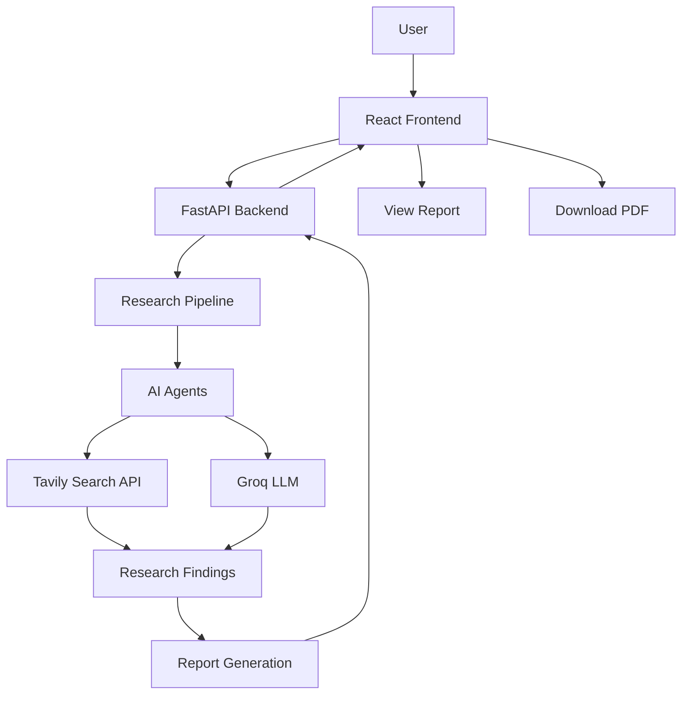

# ResearchFlow AI

**An AI-powered multi-agent research assistant that automates web research, information analysis, and report generation.**

ResearchFlow AI uses a multi-agent architecture to research user-provided topics, gather relevant information from the web, analyze findings, and generate structured research reports.

<p align="center">
  <a href="https://researchflow-ai-frontend.onrender.com">Live Application</a> ·
  <a href="https://researchflow-ai-backend.onrender.com/docs">API Documentation</a> ·
  <a href="https://github.com/shashikant-bhardwaj/researchflow-ai">GitHub Repository</a>
</p>

---

## Table of Contents

- [Overview](#overview)
- [Features](#features)
- [How It Works](#how-it-works)
- [System Architecture](#system-architecture)
- [Technology Stack](#technology-stack)
- [Project Structure](#project-structure)
- [Getting Started](#getting-started)
- [Environment Configuration](#environment-configuration)
- [API Reference](#api-reference)
- [Deployment](#deployment)
- [Future Enhancements](#future-enhancements)
- [Contributing](#contributing)
- [Author](#author)

---

## Overview

ResearchFlow AI is designed to simplify the research process by combining AI agents, large language models, and web search capabilities into a single application.

Users can submit a research topic through the web interface. The backend coordinates the research workflow, retrieves relevant information using Tavily, processes findings with Groq-powered language models, and returns a structured research report.

The application follows a modular architecture, separating the frontend, API layer, research pipeline, agents, and external tools.

## Features

- **Multi-Agent Research Workflow:** Coordinates specialized AI agents to perform research-related tasks.
- **Web Search Integration:** Retrieves relevant information using the Tavily Search API.
- **AI-Powered Analysis:** Uses Groq LLMs to process and analyze collected information.
- **Automated Report Generation:** Produces structured research reports from gathered findings.
- **PDF Export:** Allows users to download generated reports as PDF files.
- **Interactive Web Interface:** Provides a simple interface for submitting research topics and viewing results.
- **REST API:** Exposes research functionality through a FastAPI backend.
- **Modular Backend:** Separates agents, tools, API endpoints, and pipeline logic for maintainability.

## How It Works

1. **Topic Submission:** The user enters a research topic through the React frontend.
2. **API Request:** The frontend sends the topic to the FastAPI backend.
3. **Research Orchestration:** The research pipeline coordinates the required agents.
4. **Information Retrieval:** The agents use Tavily to search for relevant web information.
5. **Information Analysis:** Groq-powered language models process and analyze the collected information.
6. **Report Generation:** The pipeline combines the findings into a structured research report.
7. **Report Delivery:** The backend returns the generated report to the frontend, where users can view and download it as a PDF.

## System Architecture



## Technology Stack

| Category | Technologies |
|---|---|
| Frontend | React.js, Vite, JavaScript |
| Styling | Tailwind CSS |
| Backend | Python, FastAPI, Uvicorn |
| AI Orchestration | LangChain |
| Language Models | Groq |
| Web Search | Tavily Search API |
| Package Management | uv, npm |
| Version Control | Git, GitHub |
| Deployment | Render |

## Project Structure

```text
researchflow-ai/
│
├── Backend/
│   ├── src/
│   │   └── multi_agent_system/
│   │       ├── __init__.py
│   │       ├── agents.py
│   │       ├── api.py
│   │       ├── pipeline.py
│   │       └── tools.py
│   │
│   ├── pyproject.toml
│   └── uv.lock
│
├── Frontend/
│   ├── public/
│   ├── src/
│   │   ├── components/
│   │   ├── pages/
│   │   ├── services/
│   │   └── ...
│   ├── package.json
│   └── vite.config.js
│
└── README.md
```

## Getting Started

Follow the instructions below to set up and run ResearchFlow AI locally.

### Prerequisites

Make sure the following tools are installed:

- [Git](https://git-scm.com/)
- [Node.js and npm](https://nodejs.org/)
- [Python](https://www.python.org/)
- [uv](https://docs.astral.sh/uv/)

You will also need API keys from:

- [Groq](https://console.groq.com/)
- [Tavily](https://tavily.com/)

### 1. Clone the Repository

```bash
git clone https://github.com/shashikant-bhardwaj/researchflow-ai.git

cd researchflow-ai
```

### 2. Configure the Backend

Navigate to the backend directory:

```bash
cd Backend
```

Install the project dependencies:

```bash
uv sync
```

Create a `.env` file inside the `Backend` directory and configure the required API keys:

```env
GROQ_API_KEY=your_groq_api_key
TAVILY_API_KEY=your_tavily_api_key
```

Start the FastAPI development server:

```bash
uv run --no-sync python -m uvicorn multi_agent_system.api:app --app-dir src --reload
```

The backend will be available at:

- API: `http://127.0.0.1:8000`
- Interactive API documentation: `http://127.0.0.1:8000/docs`

### 3. Configure the Frontend

Open a new terminal and navigate to the project root:

```bash
cd Frontend
```

Install frontend dependencies:

```bash
npm install
```

Create a `.env` file inside the `Frontend` directory:

```env
VITE_API_BASE_URL=http://127.0.0.1:8000
```

Start the frontend development server:

```bash
npm run dev
```

Open the application at:

`http://localhost:5173`

## Environment Configuration

The application requires the following environment variables.

### Backend — `Backend/.env`

| Variable | Description |
|---|---|
| `GROQ_API_KEY` | API key used to access Groq language models. |
| `TAVILY_API_KEY` | API key used for web search and information retrieval. |

### Frontend — `Frontend/.env`

| Variable | Description |
|---|---|
| `VITE_API_BASE_URL` | Base URL of the FastAPI backend. |

**Security:** Keep API keys and environment files private. Never commit `.env` files or expose secret keys in frontend code.

## API Reference

**Production Base URL**

```text
https://researchflow-ai-backend.onrender.com
```

### Health Check

Checks whether the backend API is running.

| Property | Value |
|---|---|
| Method | `GET` |
| Endpoint | `/` |

Example response:

```json
{
  "message": "Research API is running"
}
```

### Generate Research Report

Starts the research workflow and returns the generated report.

| Property | Value |
|---|---|
| Method | `POST` |
| Endpoint | `/research` |

For the exact request body, response schema, and endpoint details, refer to the interactive FastAPI documentation:

[View API Documentation](https://researchflow-ai-backend.onrender.com/docs)

## Deployment

ResearchFlow AI is deployed on [Render](https://render.com/) using two independent services.

### Backend Service

| Setting | Configuration |
|---|---|
| Root Directory | `Backend` |
| Build Command | `pip install uv && uv sync --frozen` |
| Start Command | `uv run --no-sync uvicorn multi_agent_system.api:app --app-dir src --host 0.0.0.0 --port $PORT` |

Required environment variables:

- `GROQ_API_KEY`
- `TAVILY_API_KEY`

### Frontend Service

| Setting | Configuration |
|---|---|
| Root Directory | `Frontend` |
| Build Command | `npm install && npm run build` |
| Publish Directory | `dist` |

Environment variable:

```env
VITE_API_BASE_URL=https://researchflow-ai-backend.onrender.com
```

**Note:** Vite environment variables are embedded during the frontend build. If you change the API URL, trigger a new frontend deployment so the updated value is applied.

## Future Enhancements

The following improvements are planned for future versions:

- [ ] **Research History:** Store previously generated research reports in a database so users can revisit their research later.
- [ ] **User Authentication:** Add secure user accounts and personalized research workspaces.
- [ ] **Report Management:** Enable users to search, organize, and delete saved research reports.
- [ ] **Source Citations:** Include properly formatted references and source links in generated reports.
- [ ] **Streaming Responses:** Display research progress and generated results in real time.
- [ ] **Fact Verification:** Introduce an additional verification stage to improve the reliability of generated information.

## Contributing

Contributions, bug reports, and feature suggestions are welcome.

To contribute:

1. Fork the repository.
2. Create a feature branch:

   ```bash
   git checkout -b feature/your-feature-name
   ```

3. Commit your changes:

   ```bash
   git commit -m "Add: describe your changes"
   ```

4. Push your branch:

   ```bash
   git push origin feature/your-feature-name
   ```

5. Open a Pull Request.

## Author

**Shashikant Bhardwaj**

- GitHub: [shashikant-bhardwaj](https://github.com/shashikant-bhardwaj)

---

If you find this project useful, consider giving the repository a star on GitHub.